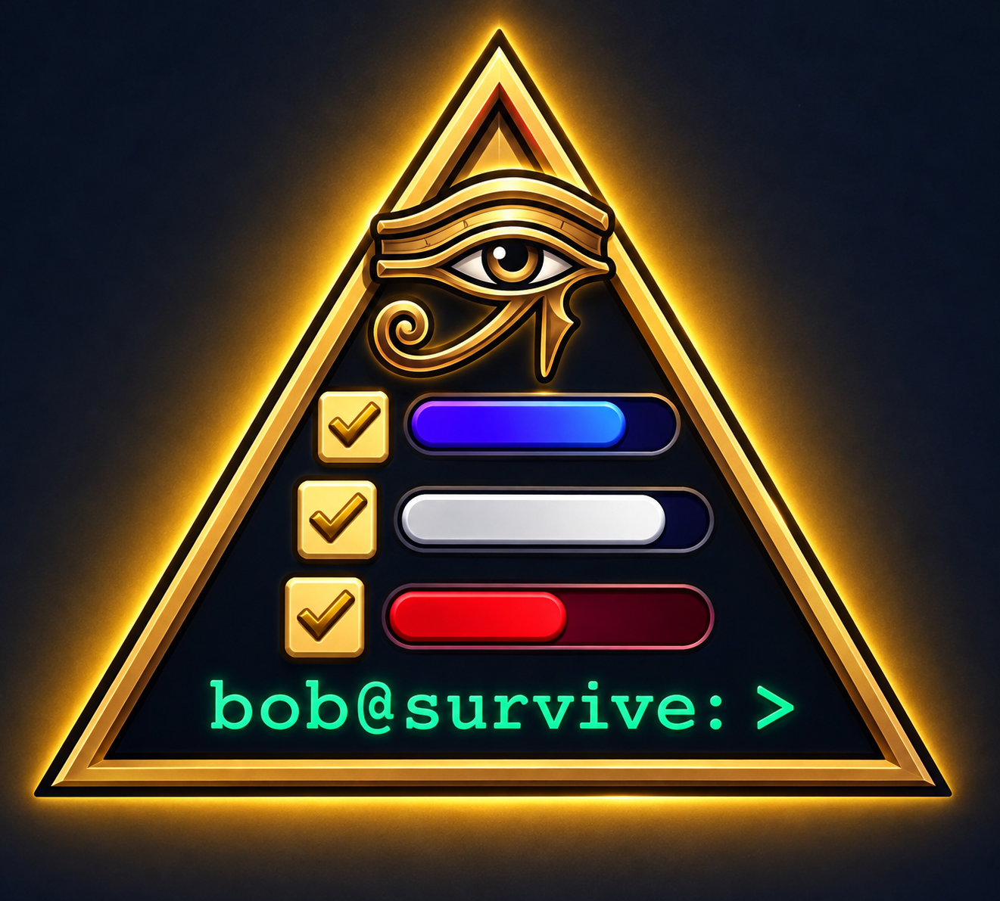

<!-- prettier-ignore -->
<div align="center">
  

# to_do

_A minimal, polished, local-first Flutter todo app — with end-to-end encrypted sync_

[](https://flutter.dev)
[](https://dart.dev)
[](https://flutter.dev/multi-platform)
[](LICENSE)

If you like this project, star it ⭐!

[Features](#features) • [Getting started](#getting-started) • [Usage](#usage) • [Encrypted sync](#encrypted-sync-optional) • [Security](#security--credentials) • [How it works](#how-it-works) • [Examples](#examples) • [Troubleshooting](#troubleshooting)

</div>

**to_do** is a local-first todo app built with Flutter and Material 3. Your tasks and categories live in AES-encrypted boxes on your device, and an optional [Supabase](https://supabase.com) backend keeps your devices in sync end-to-end encrypted — the server only ever stores ciphertext it cannot read. One codebase runs on Android, iOS, Linux, macOS, web, and Windows.

> [!TIP]
> There is nothing to configure to get started. Without Supabase keys the app runs entirely offline in local-only mode and manages its own encryption key transparently — no accounts, no cloud.

## Features

- **Local-first** — tasks and categories live in encrypted on-device storage; every feature works fully offline
- **End-to-end encryption** — the master key never leaves your device; sync payloads are sealed with AES-256-GCM before they are uploaded
- **Optional Supabase sync** — debounced push, watermark-based pull, and tombstoned deletes against a single `items` table
- **Recovery key** — a one-time 64-hex key restores your data on a new device, verified against the server before it is saved
- **Color-coded categories** — reorderable, with a custom HSV color picker and a protected Quick Tasks list
- **Gesture-driven** — swipe to complete or delete, drag to reorder, edge-swipe navigation, and a persistent quick-add bar for rapid entry
- **Multi-line tasks** — the quick-add bar accepts newlines and pasted lists; long titles expand in the list (up to 8 lines) instead of always truncating to 2
- **Undo-friendly** — deleted tasks and whole categories can be restored from the snackbar, positions included
- **Polished details** — time-of-day greetings, confetti when you clear a list, and a satisfying check sound
- **Six platforms** — Android, iOS, Linux, macOS, web, and Windows from a single codebase

## Getting started

### Prerequisites

- [Flutter SDK](https://docs.flutter.dev/get-started/install) **3.44+** (Dart 3.13+ ships with it)
- The toolchain for your target platform:
  - **Android** — Android SDK (bundled with Android Studio)
  - **iOS / macOS** — Xcode with command-line tools
  - **Windows** — Visual Studio with the _Desktop development with C++_ workload
  - **Linux** — GTK 3 development packages, e.g. `sudo apt install libgtk-3-dev`
  - **Web** — any modern browser
- Run `flutter doctor` to confirm your setup.

### Run the app

```bash
git clone https://github.com/your-username/to_do.git
cd to_do
flutter pub get

# Local-only mode (no sync, fully offline)
flutter run

# With Supabase sync (injects credentials at compile-time)
cp secrets.example.json secrets.json
# Add your Supabase URL and Anon Key to secrets.json
flutter run --dart-define-from-file=secrets.json
```

On first launch the app creates the default Quick Tasks category and — in local-only mode — quietly generates and stores an encryption key for you. Add a task and you are off.

## Usage

The three things worth knowing:

1. Tap **+** to open the quick-add bar — the field keeps focus after each add for rapid entry, and accepts multi-line text (Enter inserts a newline; the ↑ button submits)
2. Swipe a row **right** to complete it or **left** to delete it, and drag rows to reorder
3. Open categories with the home button or a swipe from the **left screen edge**

| Action                | How                                                                 |
| --------------------- | ------------------------------------------------------------------- |
| Add a task            | **+** button — the quick-add bar keeps focus for back-to-back entry |
| Complete / uncomplete | Tap the checkbox, or swipe the row right                            |
| Delete                | Swipe the row left, trash icon, or menu → Delete All Tasks          |
| Edit a title          | Tap the row — the bottom sheet saves from the check button          |
| Reorder               | Long-press and drag active tasks                                    |
| Switch category       | Home button, or drag from the left edge                             |
| Back from categories  | Drag from the right edge                                            |
| Undo a delete         | **UNDO** on the snackbar — works for tasks and whole categories     |

Deleting a category asks what to do with its tasks (move them to Quick Tasks, or delete them) and stays undoable either way. Completed tasks drop below a _Completed_ header and are muted; clearing the last active task in a category earns a little confetti. On launch the app greets you — it asks for your name once, and skipping is fine.

### The quick-add bar

Tapping **+** opens a capsule-shaped field in place of the FAB row — the two buttons slide down and the bar slides up into their slot, so the layout around it never jumps.

The capsule is tinted in the current category's color and reads as a solid surface:

- **Opaque fill** — the tint is blended over the surface color instead of laid down as a translucent overlay, so task rows underneath cannot bleed through while you type
- **Focus ring** — a 2 px category-colored border appears while the field has focus
- **Leading ✕** — closes the bar; system back and tapping outside also work
- **Trailing ↑** — submits the task; stays disabled until the field contains non-whitespace text

**Rapid entry.** After each submit the field clears and keeps focus, so the keyboard never drops between items.

**Multi-line input.** The field starts at one line, grows as you type, and caps at four lines before scrolling internally. **Enter inserts a newline** rather than submitting, so a pasted list works directly:

```
Groceries
- milk
- eggs
- bread
```

Newlines and `- ` markers are plain characters — they are stored, sealed, and synced exactly as typed; nothing transforms them into styled bullets. A title containing a newline expands to up to **8 visible lines** (`kTaskTitleMultilineMaxLines`) in the list instead of the usual 2 (`kTaskTitleMaxLines`). Both caps ellipsize; tapping the tile opens the full text in the edit sheet, which has no upper limit and remains the source of truth.

## Encrypted sync (optional)

Sync uses any Supabase project and a single `items` table. The server never sees plaintext: every payload is sealed under a key derived on your device, and row-level security scopes the table to signed-in users.

**1. Create the table** — in the Supabase SQL Editor:

```sql
create table public.items (
  user_id    uuid not null default auth.uid() references auth.users(id),
  id         text not null,
  kind       text not null,        -- 'task' | 'category' | 'meta'
  data       text not null,        -- sealed payload
  deleted_at timestamptz,          -- tombstone timestamp, or null
  updated_at timestamptz not null default now(),
  primary key (user_id, id)
);

-- keep updated_at server-managed on every write
create or replace function public.touch_updated_at()
returns trigger language plpgsql as $$
begin
  new.updated_at = now();
  return new;
end;
$$;

create trigger items_touch_updated_at
  before update on public.items
  for each row execute function public.touch_updated_at();

alter table public.items enable row level security;

-- A single, strict policy for all operations (select, insert, update, delete)
create policy "Users can only access their own items"
  on public.items for all to authenticated
  using (auth.uid() = user_id)
  with check (auth.uid() = user_id);

-- Index for the watermark-based pull loop
create index idx_items_user_id_updated_at on public.items (user_id, updated_at desc);
```

> [!IMPORTANT]
> The pull loop advances a watermark based on `updated_at`, so the default value and the trigger above are required — without them, edits made on one device stop appearing on the others.

**2. Point the app at your project** — copy the URL and anon key from _Project Settings → API_ into a local `secrets.json` file (copy from `secrets.example.json`), then run the app with the `--dart-define-from-file` flag. This injects the credentials at compile-time without hardcoding them in your source tree.

**3. Sign in and adopt a key** — create an account (email + password) in the app, then choose _Set up encryption_:

- The app shows a 64-character recovery key **exactly once** — save it somewhere safe
- The key is verified against a sealed canary row on the server _before_ anything is stored
- On your other devices, sign in and choose _I already have a recovery key_

> [!WARNING]
> The recovery key is shown only once, and nobody — including the server — can reset it. Without it, encrypted data cannot be restored on a new device.

After that, sync runs itself: edits push within a second of typing, remote changes are pulled every 15 seconds, and deletions propagate as tombstones. If the server reports a different key, sync pauses with a banner while your local data stays fully usable — see [Troubleshooting](#troubleshooting).

## Security & Credentials

> [!WARNING]
> **Client-Side Credentials Exposure**
> This app uses Supabase for backend services. The `anonKey` used in this application is a **public-facing API key**, not a secret master password.
>
> If you compile this app into an APK/IPA, these credentials **will** be embedded in the binary and can be extracted by anyone who reverse-engineers the package. This is standard for client-side applications.
>
> **Your actual security boundary is Row Level Security (RLS).**
> Do not rely on keeping the `anonKey` secret. Ensure your Supabase RLS policies are strictly configured so that an authenticated user can only read, modify, and delete their own rows. If your RLS is misconfigured, an extracted `anonKey` will grant full access to your database.

## How it works

**Key hierarchy** — one 32-byte master key, generated on-device and kept in the platform's secure storage (Android Keystore, iOS Keychain, Linux Secret Service, ...). It never leaves the device and is never derived from a password:

```
master key (32 random bytes)
 ├── HKDF-SHA256 → local-db key  → AES cipher for the encrypted Hive boxes
 └── HKDF-SHA256 → sync key      → AES-256-GCM envelope for every synced payload
```

Each sealed payload is authenticated against its row kind and id as AEAD associated data, so a ciphertext captured for one row cannot be replayed as another.

**Sync model** — a single-user, last-write-wins design sized for one person on a few devices:

- **Verify first** — before any pull or push, this device's key must open a sealed canary row on the server. A mismatching key can never overwrite server data; sync simply pauses.
- **Push** — Hive box watchers debounce (600 ms) into batched upserts; deletions become tombstones.
- **Pull** — every 15 s, rows newer than the stored watermark (microsecond precision) are applied.
- **No echo loops** — pulled rows are compared by decoded content, not ciphertext, because fresh nonces make every seal unique.
- **Verify-before-save** — during key setup, the canary check runs before anything is persisted, so losing the adoption race against another device leaves secure storage untouched.

**At rest** — the task and category boxes are AES-encrypted; the small settings box holds only flags, the sync watermark and your display name. Legacy plaintext boxes from earlier versions are migrated once, verified record by record, and only then deleted. Logs record error types only — never key material or payload text.

## Examples

**Run on a specific platform**

```bash
# Local-only
flutter run -d chrome
flutter run -d linux

# With Supabase sync
flutter run -d macos --dart-define-from-file=secrets.json
flutter run -d windows --dart-define-from-file=secrets.json
flutter run -d <device-id> --dart-define-from-file=secrets.json
```

**Test and verify**

```bash
flutter test                                            # widget and unit tests
dart --enable-asserts lib/services/crypto_service.dart  # crypto self-check on the plain Dart VM
flutter analyze                                         # static analysis
```

**Regenerate code and assets**

```bash
dart run build_runner build --delete-conflicting-outputs  # Hive adapters, after model changes
dart run flutter_launcher_icons                           # launcher icons from assets/icon/app_icon.png
```

**Build for release**

```bash
# Remember to inject your secrets if you want sync enabled in the release build!
flutter build apk --release --dart-define-from-file=secrets.json       # Android
flutter build web --release --dart-define-from-file=secrets.json
flutter build linux --release --dart-define-from-file=secrets.json
flutter build macos --release --dart-define-from-file=secrets.json     # needs macOS
flutter build windows --release --dart-define-from-file=secrets.json   # needs Visual Studio
flutter build ios --release --dart-define-from-file=secrets.json       # needs macOS + Xcode
```

**Make it yours** — a few constants to start from:

- Time-of-day greetings: the `kGreeting*` variant lists in `lib/constants.dart`
- Category color palette: `kCategoryPalette` in `lib/constants.dart`
- Multi-line title expansion in the list: `kTaskTitleMultilineMaxLines` in `lib/constants.dart`
- Check sound: replace `assets/sounds/check.mp3`

## Troubleshooting

### Sync is paused: the encryption key does not match the server

The server's canary was sealed with a different key — usually another device adopted one first, or the server was reset. Nothing is pushed while the banner shows, and your local tasks remain fully usable. To resync, restore the correct key via _I already have a recovery key_, then restart the app.

### Local data could not be opened

The encrypted boxes failed to open with this device's key — the key changed, or the local files are damaged. The error screen offers **Reset local data and re-sync** behind an explicit confirmation; unsynced edits are lost, everything already synced is downloaded again.

### I lost my recovery key

There is no password reset and no server-side plaintext: a lost recovery key means encrypted data cannot be restored on any new device. While one device still works and holds its key, your data is safe and syncing there — set up any additional devices before signing out of that one.

### Something else

Please [open an issue](https://github.com/fathriAbanoub/to_do/issues) with your platform, the error text, and what you were doing.

## License

MIT © 2026 [fathriAbanoub](https://github.com/fathriAbanoub)

See [LICENSE](LICENSE) for details.
